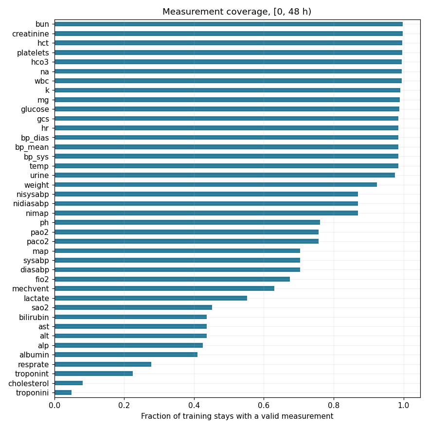
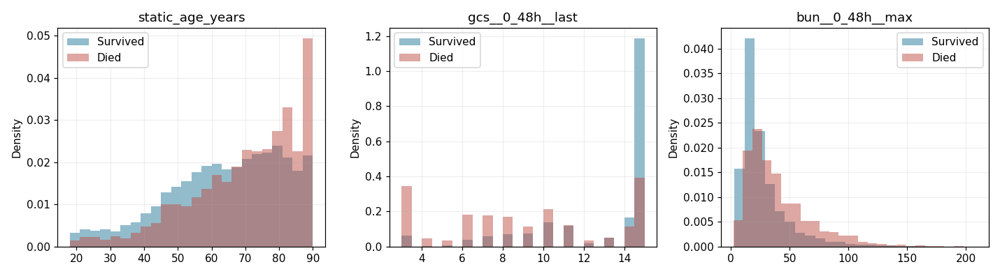
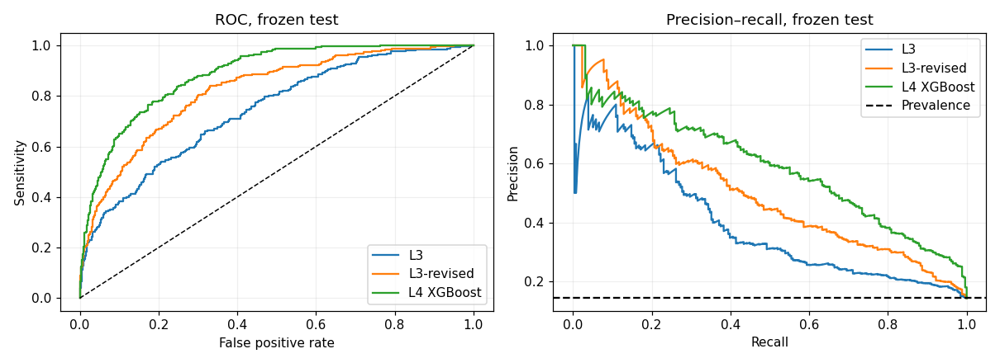
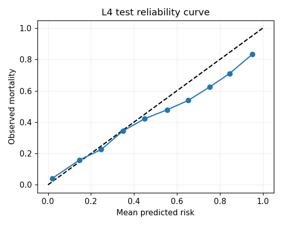
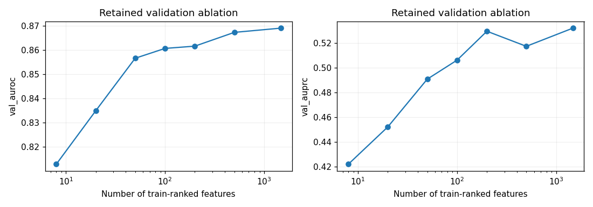

# Saved notebook outputs

These files are exported by [In_Hospital_Death.ipynb](../../In_Hospital_Death.ipynb) in its default CPU replay. They cover the same reviewed **11,833 stays / 1,474 features** and reproduce the fixed XGBoost result. Default reruns refresh these committed exports.

## Figures

The original-resolution PNGs live in `results/figures/notebook/`. Click a filename to open or download it for presentation use.

| Figure | Content | Data used |
|---|---|---|
| [eda_measurement_coverage.png](../figures/notebook/eda_measurement_coverage.png) | Valid-measurement coverage by parameter | Training stays |
| [eda_outcomes_training.png](../figures/notebook/eda_outcomes_training.png) | Age, last GCS and peak BUN distributions by outcome | Training stays |
| [roc_pr_test.png](../figures/notebook/roc_pr_test.png) | ROC and precision–recall curves for L3, revised L3 and L4 | Frozen test split |
| [calibration_test.png](../figures/notebook/calibration_test.png) | XGBoost reliability diagram | Frozen test split |
| [feature_count_validation.png](../figures/notebook/feature_count_validation.png) | Retained top-k feature ablation, rendered as AUROC/AUPRC curves | Historical validation results |

The historical SHAP summary, waterfalls and calibration figure remain in the parent [figure inventory](../figures/README.md). The notebook displays those SHAP images from the saved files; they are not counted as freshly recomputed SHAP outputs.

## Tables and verification

CSV exports retain full numerical precision; use the notebook/report for rounded presentation values. Blank threshold fields in the ladder mean the metric is omitted, not zero.

| File | Content |
|---|---|
| [tables/ladder_test.csv](tables/ladder_test.csv) | Nine baseline/model rows; AUROC/AUPRC with 95% bootstrap CIs, denominator and applicable threshold metrics |
| [tables/icu_subgroups.csv](tables/icu_subgroups.csv) | Four ICU types, event counts and L4 AUROC intervals; totals are 1,775 stays and 256 deaths |
| [tables/gcs_statistic_development.csv](tables/gcs_statistic_development.csv) | Seven GCS summaries with observed-only sample sizes/AUROC and train-median-imputed AUROC |
| [tables/reviewed_metric_checks.csv](tables/reviewed_metric_checks.csv) | Seven principal model comparisons against the reviewed AUROC/AUPRC records |
| [verification.json](verification.json) | Replay status, cohort, features, threshold, principal metrics, environment and published output paths |
| [manifest.json](manifest.json) | Package-relative paths, byte sizes and SHA-256 hashes for all 13 exported data/figure/model files |

The output manifest is separate from the frozen input manifest at `data/manifest.sha256`. It covers five PNGs, four CSVs, the verification report, two L3 bundles and their metadata. This README and the manifest itself are not self-hashed.

## Fitted logistic models

The two fitted L3 pipelines are committed under [models/notebook/](../../models/notebook/). Each bundle contains its ordered eight-feature list, fitted imputer/scaler/logistic pipeline and validation-derived threshold. [model_metadata.json](../../models/notebook/model_metadata.json) records feature lists, fitting recipe, split/estimator seeds, training counts and environment. See the [model guide](../../models/README.md) for loading instructions.

The saved bundles are CPU reproductions of the declared L3 recipes. The selected historical L4 model remains `models/L4_xgboost_best.json`; the L3 exports do not change historical model selection. New exploratory search/refit files stay in the ignored `artifacts/notebook/` directory until reviewed.
